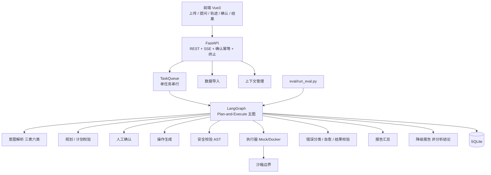

# architecture.md — DataReflex v1 架构总览

> 本文是架构入口文档，与 [`spec.md`](spec.md)、[`design.md`](design.md)、[`conventions.md`](conventions.md) 对齐。  
> 字段契约见 [`schema.md`](schema.md)；默认值见 [`defaults.md`](defaults.md)；快速开始见根目录 [`README.md`](../README.md)。

## 1. 定位与边界

**DataReflex** 是面向固定结构化数据集的自然语言分析系统：用户上传数据并用中文提问，系统按 **Plan-and-Execute** 编排规划、隔离执行与定向自愈，输出结论、表格与图表。

**v1 硬边界：**

| 项 | 约定 |
| :--- | :--- |
| 数据范围 | 固定三表：`orders` / `returns` / `users` |
| 问题范围 | 固定六类：退货率 TopN、渠道对比、时间趋势、用户分层对比、促销对比、复购率 |
| 读写 | 只读分析；危险写与越权字段拦截 |
| 调度 | **单任务串行**队列，禁止多任务并发写库 |
| 上下文 | 同数据集最近 **1–2 轮**；切换数据集清空；无法解析指代必须澄清 |
| 降级 | 模型不可用且开关开启时，输出标注 **「非分析结论」** 的静态诊断报告 |
| 执行 | 生成代码不在宿主机执行；生产路径为 Docker 一次性容器（演示可用 Mock） |

## 2. 系统架构图

实现主路径代码：

- API / 队列：`src/data_reflex/api/`
- Graph：`src/data_reflex/graph_engine/`
- 业务模块：`src/data_reflex/modules/`
- 前端：`frontend/`
- 评测：`eval/run_eval.py` + `eval/datasets/core.jsonl`

## 3. 模块职责（摘要）

| 模块 | 职责 | 主要实现 |
| :--- | :--- | :--- |
| API 网关 | 上传、提问、确认、终止；SSE `after_seq` 补发；统一错误信封 | `api/` |
| 任务调度 | v1 **单任务串行**；写库串行 | `api/queue.py` |
| 数据导入 | 单 sheet、编码探测、列重命名、大小限制 | `modules/data_import/` |
| 上下文 | 同数据集 1–2 轮；新话题规则；指代失败澄清 | `modules/context/` |
| 意图解析 | 三表六类 / 超范围拒绝 / 约束转显式 | `modules/intent_parse/` |
| 规划与校验 | 子任务拆解、环与缺失输入检测 | `modules/plan*` |
| 人工确认 | 默认开启；超时拒绝；危险不放行 | `modules/human_confirm/` |
| 操作生成 | SQL/Python 模板；格式重试 1 次 | `modules/generate_op/` |
| 安全校验 | sqlglot / Python AST；字段白名单 | `modules/safety_check/` |
| 隔离执行 | Protocol + Mock / Docker；禁宿主机执行 | `modules/executor/` |
| 错误 / 自愈 | 指纹、熔断、总 LLM 上限优先 | `modules/error_classify/` `reflect/` |
| 结果校验 | 仅可结构化约束 | `modules/result_validate/` |
| 报告 / 降级 | 结论表图；降级报告标 **非分析结论** | `modules/report/` |
| 审计 / 持久化 | SQLite 任务、审计、评测 | `modules/audit/` |
| 评测 | 分层集 + planner/reflector 矩阵 | `eval/` |
| 前端 | 上传、提问、轨迹、确认、表图 | `frontend/` |

细则与 IO 表见 [`design.md` §2–§3](design.md)。编码约定见 [`conventions.md`](conventions.md)。

## 4. 数据流（一次分析请求）

1. 上传 CSV/Excel → 导入模块校验并落盘 → 返回 `dataset_id`。  
2. 提问进入 **单任务串行**队列；建立 SSE；加载同数据集最近 1–2 轮上下文。  
3. 意图解析：超范围或需澄清 → 直接报告；否则进入规划。  
4. 规划 → 计划校验 →（可选）人工确认。  
5. 对子任务：`GenerateOp` → `SafetyCheck` → `Execute`。  
6. 失败 → 错误分类 →（可自愈）Reflect 回环；成功 → 结果校验。  
7. 汇总报告；若模型不可用且 `enable_fallback_report` → 降级报告（**非分析结论**）。  
8. 全程写审计；终止时杀容器并保留已完成结果。

评测流：`core.jsonl` → `run_eval.py --mode mock` → `eval/results/`（泄漏用例不进指标分母）。

## 5. Graph 节点一览

| 节点 | 作用 |
| :--- | :--- |
| IntentParse | 三表六类范围与澄清 |
| Plan / PlanValidate | 拆解与校验 |
| HumanConfirmPlan | 挂起确认 |
| GenerateOp | 生成 SQL/Python |
| SafetyCheck | 危险写 / 越权拦截 |
| Execute | Mock 或 Docker 执行 |
| ErrorClassify / Reflect | 归类与自愈 |
| ResultValidate | 结构化约束 |
| Report / FallbackReport | 正式报告 / 降级（非分析结论） |

策略开关（`enable_planner` / `enable_reflector` / `enable_sandbox` / `enable_human_confirm` / `enable_fallback_report`）共用同一主图，不复制第二套业务代码。详见 [D-FLAG-01](tasks.md#D-FLAG-01)。

## 6. ADR-001 ～ ADR-018 摘要

完整条文见 [`design.md` §7](design.md#7-决策记录adr)。

| ID | 一句话 |
| :--- | :--- |
| [ADR-001](design.md#ADR-001) | 编排用 LangGraph（状态机 / 回环 / Checkpoint） |
| [ADR-002](design.md#ADR-002) | 范式用 **Plan-and-Execute**，不用纯 ReAct |
| [ADR-003](design.md#ADR-003) | 执行用 Docker 沙箱；宿主机禁止执行生成代码 |
| [ADR-004](design.md#ADR-004) | 可观测用 Langfuse，可 no-op |
| [ADR-005](design.md#ADR-005) | 评估：断言式用例 + 自研报表脚本 |
| [ADR-006](design.md#ADR-006) | 主模型 GLM-4，不宣称唯一最优 |
| [ADR-007](design.md#ADR-007) | 持久化 SQLite |
| [ADR-008](design.md#ADR-008) | v1 不引入 Redis |
| [ADR-009](design.md#ADR-009) | Schema 直接注入，不做混合检索 |
| [ADR-010](design.md#ADR-010) | 固定三表六类 + 多轮增量，不做通用 NL2SQL |
| [ADR-011](design.md#ADR-011) | 消融用配置开关 + 统一评测，不复制两套系统 |
| [ADR-012](design.md#ADR-012) | 状态推送用 SSE |
| [ADR-013](design.md#ADR-013) | 前端 Vue 3 + Vite，轻量工作台 |
| [ADR-014](design.md#ADR-014) | 本地审计表 + 自托管追踪；只记字段名 |
| [ADR-015](design.md#ADR-015) | 模型不可用 → 静态诊断，标注 **非分析结论**，不自动切备用模型 |
| [ADR-016](design.md#ADR-016) | **单任务串行**，不做多任务并发 |
| [ADR-017](design.md#ADR-017) | 结果校验只校验可结构化约束 |
| [ADR-018](design.md#ADR-018) | 上下文同数据集最近 1–2 轮；指代失败必须澄清 |

## 7. 与规格文档的对应关系

| 主题 | 规格 / 设计出处 |
| :--- | :--- |
| 功能与排除项 | [`spec.md`](spec.md) |
| 模块 IO、节点、ADR 全文 | [`design.md`](design.md) |
| 异常 / 日志 / 目录约定 | [`conventions.md`](conventions.md) |
| 三表六类字段 | [`schema.md`](schema.md) |
| 开关与限额 | [`defaults.md`](defaults.md) |
| 任务与实现决策 | [`tasks.md`](tasks.md) |

## 8. v1 演示与执行器说明

- **演示默认**：API 队列使用 `MockSandboxExecutor`，用于跑通 Plan-and-Execute 与前端，不保证结果数字等于 fixtures 金标准。  
- **真实执行**：应切换为 `DockerSandboxExecutor` + 镜像 `data-reflex-sandbox:3.11`（见 defaults）；Docker 不可用返回错误，**不**降级宿主机执行。  
- **降级报告**：与沙箱无关；关注模型不可用时的 **非分析结论** 兜底（ADR-015）。
