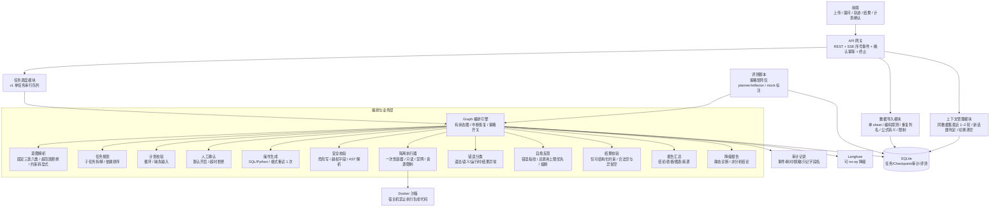

# design.md

## 1. 系统架构图

## 2. 模块划分与职责

| 模块 | 职责 |
| :--- | :--- |
| **API 网关** | 接收上传、提问、确认、终止请求；SSE 推送带任务标识与事件序号，支持断线按序号补发；确认接口幂等；终止时通知执行器杀容器；统一错误响应。 |
| **任务调度模块** | v1 单任务串行队列；任务状态写入串行化；禁止多任务并发写库。 |
| **数据导入模块** | 解析 CSV/Excel，只读单工作表；识别字段名、类型、样本值、空值比例；重复列名自动重命名，保留中文列名，转义公式前缀，不执行宏；坏文件跳过并告警；执行文件数量与大小限制。 |
| **上下文管理模块** | 维护同一数据集内最近 1–2 轮计划、结果、约束；切换数据集清空；按固定规则判定新话题并隔离；无法解析指代时要求澄清。 |
| **意图解析模块** | 判断请求是否属于固定三表与六类问题；超范围拒绝并说明；无法转为显式条件的自然语言约束要求澄清。 |
| **任务规划模块** | 将分析请求拆解为有序子任务，标注输入、输出、依赖与并行组。 |
| **计划校验模块** | 检测循环依赖、缺失输入、超出支持范围；失败终止并输出原因。 |
| **人工确认模块** | 默认开启计划确认；挂起等待批准、拒绝或超时；超时按拒绝；拒绝保留已完成结果；危险操作不进入人工放行。 |
| **操作生成模块** | 为每个子任务生成结构化查询语句或数据处理脚本及预期输入输出；格式非法最多重试 1 次；耗尽标记该子任务失败并继续其他子任务。 |
| **安全校验模块** | SQL 用 AST 解析写操作与字段白名单；Python 禁用危险内建与动态导入；运行期二次只读与字段校验；危险写与越权字段直接拦截。（实现见 [D-SAFE-01](tasks.md#D-SAFE-01)） |
| **隔离执行器** | 一次性 Docker 容器，只读挂载数据、禁用网络、限制 CPU/内存/进程数/超时；宿主机绝对禁止执行生成代码；Docker 不可用返回错误不降级；关闭隔离仅评测且仍用容器；终止时杀容器。 |
| **错误分类模块** | 归类语法、字段语义、运行时、结果异常；输出可重试性与修复提示。 |
| **自愈反思模块** | 错误指纹 = 错误类型 + 归一化关键错误行；连续两次相同指纹或达重试上限熔断；总模型调用上限优先；仅重跑失败子任务；记录修复前后差异。 |
| **结果校验模块** | 只校验可结构化约束（比例范围、非空、字段存在、行数上限）；空结果区分合法空与异常空；异常可自愈则回环，不可自愈说明；敏感字段按规则脱敏。 |
| **报告汇总模块** | 汇总结论、表格、图表、来源映射、失败归因；图表仅柱状图、折线图、表格；不支持类型说明并给替代，不伪造。 |
| **降级报告模块** | 模型重试耗尽且开关开启时输出静态诊断报告：数据概况、请求解析状态、失败节点与影响范围、可手动执行字段与模板建议、已完成子任务结果；开头标注“非分析结论”；不生成新查询/脚本。 |
| **审计记录模块** | 记录规划、执行、失败、自愈、熔断、人工拦截、终止、完成、降级触发；按任务追溯；日志与审计只记字段名不记值；敏感字段脱敏。（实现见 [D-STORE-01](tasks.md#D-STORE-01)：`audit_events` + payload 脱敏） |
| **评测运行模块** | 固定评测集分层；先 30 条核心再扩 50+；策略矩阵仅 planner/reflector 开关，其余默认；检查数据泄漏；固定时钟、时区、模型参数；单用例失败继续；报表标注 mock 或真实模式；区分执行成功率与结果准确率。 |
| **配置模块** | 集中管理策略开关、`max_retry_rounds`、`max_llm_calls_per_task`、沙箱资源、`max_upload_files`、`max_file_size_mb`、`enable_fallback_report`、新话题判定规则、敏感字段名单。 |
| **持久化模块** | SQLite 存储任务、Checkpoint、审计、评测集与结果；写操作串行化。 |

> **【实现决策｜见 [D-STORE-01](tasks.md#D-STORE-01)】** 持久化实现选用标准库 `sqlite3` + 进程锁串行写、`TaskState` JSON 整包、审计时间有序；详情与原因见 [T09](tasks.md#T09)。

## 3. 模块输入输出定义

### 3.1 数据导入模块

> **【实现决策｜见 [D-IMPORT-01](tasks.md#D-IMPORT-01)】** 超限整单拒绝 vs 坏文件跳过、重复列命名、公式转义、单 sheet、Join 与脱敏样本值；详情与原因见 [T10](tasks.md#T10)。

**输入 `DataImportReq`**

| 字段 | 类型 | 含义 |
| :--- | :--- | :--- |
| `file_paths` | `list[str]` | 待导入的 CSV/Excel 文件路径列表 |
| `file_encoding` | `str \| None` | 可选，指定编码；为空时自动探测 |

**输出 `DataImportResp`**

| 字段 | 类型 | 含义 |
| :--- | :--- | :--- |
| `dataset_id` | `str` | 数据集唯一标识 |
| `success` | `bool` | 是否整体导入成功 |
| `tables` | `list[TableSchema]` | 每个文件的字段结构摘要 |
| `warnings` | `list[str]` | 跳过的无效文件或字段告警 |
| `error_msg` | `str \| None` | 整体失败原因 |

`TableSchema`：`file_name: str`、`row_count: int`、`columns: list[ColumnSchema]`、`join_hints: list[JoinHint]`。  
`ColumnSchema`：`name: str`、`dtype: str`、`null_ratio: float`、`sample_values: list[str]`。  
`JoinHint`：`left_file: str`、`left_column: str`、`right_file: str`、`right_column: str`、`confidence: float`。

### 3.2 上下文管理模块

**输入 `ContextManageReq`**

| 字段 | 类型 | 含义 |
| :--- | :--- | :--- |
| `dataset_id` | `str` | 当前数据集标识 |
| `previous_dataset_id` | `str \| None` | 上一轮数据集标识 |
| `conversation_context` | `list[dict]` | 历史轮次计划、结果、约束 |
| `user_query` | `str` | 当前请求 |

**输出 `ContextManageResp`**

| 字段 | 类型 | 含义 |
| :--- | :--- | :--- |
| `active_context` | `list[dict]` | 保留的同数据集最近 1–2 轮上下文 |
| `is_new_topic` | `bool` | 是否判定为新话题 |
| `context_cleared` | `bool` | 是否因切换数据集清空 |
| `clarification_required` | `bool` | 是否因指代无法解析需要澄清 |
| `clarification_questions` | `list[str]` | 澄清问题列表 |

> **【实现决策｜见 [D-CTX-01](tasks.md#D-CTX-01)】** 固定规则 `dataset_or_label_change_without_anaphora`；轮次键与指代词表；`question_tag` 经 `manage(..., question_tag=)` 可选参数传入（不改 Req）；详情与原因见 [T18](tasks.md#T18)。

### 3.3 意图解析模块

**输入 `IntentParseReq`**

| 字段 | 类型 | 含义 |
| :--- | :--- | :--- |
| `dataset_id` | `str` | 当前数据集标识 |
| `user_query` | `str` | 用户自然语言请求 |
| `conversation_context` | `list[dict]` | 同一会话内最近 1–2 轮上下文 |

**输出 `IntentParseResp`**

| 字段 | 类型 | 含义 |
| :--- | :--- | :--- |
| `in_scope` | `bool` | 是否在固定三表六类支持范围内 |
| `reject_reason` | `str \| None` | 超范围时的拒绝原因 |
| `need_clarification` | `bool` | 是否需要用户澄清 |
| `clarification_questions` | `list[str]` | 澄清问题列表 |
| `normalized_query` | `str \| None` | 归一化后的请求描述 |
| `constraints` | `list[str]` | 已转为显式条件的约束 |
| `question_tag` | `str \| None` | 六类问题标签（见下决策补注） |

> **【实现决策 D-MODEL-01｜2026-10-25】**  
> **决定：** 在 `IntentParseResp` 上增加可选字段 `question_tag`，取值对齐 `schema.md` 六类标签（`return_rate_topn` / `channel_compare` / `time_trend` / `segment_compare` / `promo_compare` / `repurchase_rate`），超范围或未判定时为 `None`。  
> **原因：** 原文 IO 表未给出「当前请求属于哪一类」的显式字段，但 `defaults.md` 新话题规则依赖「六类标签是否变化」；若标签只埋在自然语言 `normalized_query` 里，上下文管理无法稳定判定，评测也无法按层过滤。可选字段不破坏既有必填契约。  
> **依据：** [defaults.md §3](defaults.md#3-新话题规则-new_topic_rule) 新话题规则；[schema.md §7](schema.md#7-六类问题与字段依赖) 标签枚举；实现见 [`schemas.py`](../src/data_reflex/models/schemas.py)。

> **【实现决策｜见 [D-INTENT-01](tasks.md#D-INTENT-01)】** v1 规则引擎解析（无 LLM）；超范围/澄清/显式约束词表见 [T20](tasks.md#T20)；实现 `modules/intent_parse` + `Node_IntentParse`。

### 3.4 任务规划模块

**输入 `PlanReq`**

| 字段 | 类型 | 含义 |
| :--- | :--- | :--- |
| `dataset_id` | `str` | 数据集标识 |
| `normalized_query` | `str` | 归一化请求 |
| `constraints` | `list[str]` | 显式约束 |
| `conversation_context` | `list[dict]` | 上一轮上下文 |

**输出 `PlanResp`**

| 字段 | 类型 | 含义 |
| :--- | :--- | :--- |
| `success` | `bool` | 规划是否成功 |
| `sub_tasks` | `list[SubTask]` | 有序子任务列表 |
| `has_cycle` | `bool` | 是否存在循环依赖 |
| `cycle_detail` | `str \| None` | 循环依赖详情 |
| `missing_inputs` | `list[str]` | 缺失输入说明 |
| `error_msg` | `str \| None` | 规划失败原因 |

`SubTask`：`task_id: str`、`description: str`、`depends_on: list[str]`、`expected_input: dict`、`expected_output: dict`、`parallel_group: int`。

> **【实现决策｜见 [D-PLAN-01](tasks.md#D-PLAN-01)】** 六类固定两步模板、无 LLM；`question_tag` 可选参数；失败写 `PlanResp.error_msg`。详情见 [T21](tasks.md#T21)。

> **【实现决策｜见 [D-PLANVAL-01](tasks.md#D-PLANVAL-01)】** 环/缺失输入/超范围校验与 `next_node` 路由；详情见 [T22](tasks.md#T22)。

### 3.5 操作生成模块

**输入 `GenerateOpReq`**

| 字段 | 类型 | 含义 |
| :--- | :--- | :--- |
| `sub_task` | `SubTask` | 当前子任务 |
| `table_schemas` | `list[TableSchema]` | 相关数据结构 |
| `constraints` | `list[str]` | 显式约束 |
| `previous_error` | `str \| None` | 上一轮错误信息，用于自愈 |

**输出 `GenerateOpResp`**

| 字段 | 类型 | 含义 |
| :--- | :--- | :--- |
| `op_type` | `str` | `sql` 或 `python` |
| `op_content` | `str` | 查询语句或脚本内容 |
| `expected_input` | `dict` | 预期输入说明 |
| `expected_output` | `dict` | 预期输出说明 |
| `format_valid` | `bool` | 格式校验是否通过 |
| `error_msg` | `str \| None` | 格式错误原因 |

> **【实现决策｜见 [D-GENOP-01](tasks.md#D-GENOP-01)】** 模板生成 + 格式重试 1 次 + 同批继续；详情见 [T24](tasks.md#T24)。

### 3.6 安全校验模块

> **【实现决策｜见 [D-SAFE-01](tasks.md#D-SAFE-01)】** sqlglot/Python AST、`SELECT *` 一律未授权、解析失败默认拒绝；详情与原因见 [T11](tasks.md#T11)。

**输入 `SafetyCheckReq`**

| 字段 | 类型 | 含义 |
| :--- | :--- | :--- |
| `op_type` | `str` | 操作类型 |
| `op_content` | `str` | 操作内容 |
| `allowed_columns` | `list[str]` | 当前数据集授权字段 |

**输出 `SafetyCheckResp`**

| 字段 | 类型 | 含义 |
| :--- | :--- | :--- |
| `passed` | `bool` | 是否通过 |
| `violation_type` | `str \| None` | `dangerous_write`、`unauthorized_column`、`unparseable` |
| `violation_detail` | `str \| None` | 具体违规说明 |

### 3.7 隔离执行器

> **【实现决策｜见 [D-EXEC-01](tasks.md#D-EXEC-01) / [D-DOCKER-01](tasks.md#D-DOCKER-01)】** Protocol + Mock 四态见 [T12](tasks.md#T12)；Docker 一次性容器、禁网/限额/只读挂载、不可用抛 `SandboxUnavailableError`、关闭隔离仍用容器见 [T13](tasks.md#T13)。

**输入 `ExecuteReq`**

| 字段 | 类型 | 含义 |
| :--- | :--- | :--- |
| `op_type` | `str` | 操作类型 |
| `op_content` | `str` | 操作内容 |
| `dataset_id` | `str` | 数据集标识 |
| `timeout_seconds` | `int` | 执行超时 |
| `memory_limit_mb` | `int` | 内存上限 |
| `cpu_limit` | `float` | CPU 上限 |

**输出 `ExecuteResp`**

| 字段 | 类型 | 含义 |
| :--- | :--- | :--- |
| `success` | `bool` | 是否执行成功 |
| `result_rows` | `list[dict]` | 结果数据 |
| `result_columns` | `list[str]` | 结果字段 |
| `stdout` | `str` | 标准输出摘要 |
| `stderr` | `str` | 标准错误摘要 |
| `exit_code` | `int` | 退出码 |
| `duration_ms` | `int` | 执行耗时 |
| `resource_killed` | `bool` | 是否因资源超限被终止 |

### 3.8 错误分类与自愈模块

> **【实现决策｜见 [D-ERRCLS-01](tasks.md#D-ERRCLS-01)】** 错误类型优先级、指纹归一化、`resource_killed` 不可自愈；详情与原因见 [T14](tasks.md#T14)。

**输入 `ErrorClassifyReq`**

| 字段 | 类型 | 含义 |
| :--- | :--- | :--- |
| `execute_resp` | `ExecuteResp` | 执行结果 |
| `op_type` | `str` | 操作类型 |

**输出 `ErrorClassifyResp`**

| 字段 | 类型 | 含义 |
| :--- | :--- | :--- |
| `error_type` | `str` | `syntax`、`schema_semantic`、`runtime`、`result_anomaly`、`none` |
| `error_detail` | `str` | 结构化错误描述 |
| `error_fingerprint` | `str` | 错误类型 + 归一化关键错误行 |
| `retryable` | `bool` | 是否可自愈 |
| `suggested_fix` | `str \| None` | 定向修复提示 |

**输入 `ReflectReq`**

| 字段 | 类型 | 含义 |
| :--- | :--- | :--- |
| `sub_task` | `SubTask` | 失败子任务 |
| `error_classify` | `ErrorClassifyResp` | 错误分类结果 |
| `retry_count` | `int` | 当前已重试次数 |
| `max_retry` | `int` | 重试上限 |
| `llm_calls_used` | `int` | 已用模型调用次数 |
| `max_llm_calls` | `int` | 任务总模型调用上限 |
| `previous_fingerprints` | `list[str]` | 历史错误指纹 |

**输出 `ReflectResp`**

| 字段 | 类型 | 含义 |
| :--- | :--- | :--- |
| `should_retry` | `bool` | 是否继续自愈 |
| `circuit_breaker` | `bool` | 是否触发熔断 |
| `melt_reason` | `str \| None` | `duplicate_fingerprint`、`retry_limit`、`llm_call_limit` |
| `fix_hint` | `str \| None` | 注入下一轮生成的修复提示 |
| `final_status` | `str` | `retrying`、`failed`、`melted` |

### 3.9 结果校验与报告模块

> **【实现决策｜见 [D-RESULT-01](tasks.md#D-RESULT-01)】** 结构化约束白名单、合法空默认、NL 约束跳过；详情与原因见 [T15](tasks.md#T15)。

**输入 `ResultValidateReq`**

| 字段 | 类型 | 含义 |
| :--- | :--- | :--- |
| `execute_resp` | `ExecuteResp` | 执行结果 |
| `structured_constraints` | `list[dict]` | 已转为显式条件的可结构化约束 |

**输出 `ResultValidateResp`**

| 字段 | 类型 | 含义 |
| :--- | :--- | :--- |
| `valid` | `bool` | 结果是否合理 |
| `anomaly_type` | `str \| None` | `empty_anomaly`、`ratio_out_of_range`、`type_anomaly`、`constraint_mismatch` |
| `anomaly_detail` | `str \| None` | 异常说明 |

**输入 `ReportReq`**

| 字段 | 类型 | 含义 |
| :--- | :--- | :--- |
| `task_id` | `str` | 任务标识 |
| `sub_task_results` | `list[SubTaskResult]` | 各子任务结果与状态 |
| `failures` | `list[dict]` | 失败归因 |

**输出 `ReportResp`**

| 字段 | 类型 | 含义 |
| :--- | :--- | :--- |
| `summary` | `str` | 结论摘要 |
| `tables` | `list[dict]` | 结果表格 |
| `charts` | `list[ChartSpec]` | 图表配置，仅柱状图、折线图、表格 |
| `source_map` | `dict` | 结论与子任务的来源映射 |
| `partial_success` | `bool` | 是否部分成功 |

> **【实现决策 D-MODEL-02｜2026-10-25】**  
> **决定：** 补全 `SubTaskResult` / `ChartSpec` 最小字段集（原文仅点名类型、未给字段表）：  
> - `SubTaskResult`：`sub_task_id`、`status`（`pending|running|success|failed|healing|terminated`）、`result_rows`、`result_columns`、`error_summary`、`duration_ms`  
> - `ChartSpec`：`chart_type`（仅 `bar|line|table`）、`title`、`x_field`、`y_field`、`series`、`alternative_note`（不支持类型时说明替代，不伪造图）  
> **原因：** 报告/降级报告/TaskState 都依赖这两个结构；若不在模型层先锁最小字段，T16/T30/T31 会各自发明不兼容形状，SSE 与前端也无法对接。  
> **依据：** [risk.md P2-10](risk.md#risk-p2)（图表仅柱/折/表）；[defaults.md §6](defaults.md#6-前端图表) ECharts；部分成功与终止需保留已完成结果（[P0-7](risk.md#risk-p0) / [P1-9](risk.md#risk-p1)）。实现见 [`schemas.py`](../src/data_reflex/models/schemas.py)。

> **【实现决策｜见 [D-REPORT-01](tasks.md#D-REPORT-01)】** `chart_requests` 经 Builder 可选参数传入（不改 ReportReq）；partial_success / 不支持类型替代 / 空数据不伪造；详情与原因见 [T16](tasks.md#T16)。

### 3.10 降级报告模块

**输入 `FallbackReportReq`**

| 字段 | 类型 | 含义 |
| :--- | :--- | :--- |
| `task_id` | `str` | 任务标识 |
| `dataset_id` | `str` | 数据集标识 |
| `failed_node` | `str` | 失败节点 |
| `failed_sub_tasks` | `list[str]` | 未完成子任务 |
| `completed_results` | `list[SubTaskResult]` | 已完成子任务结果 |
| `parsed_keywords` | `list[str]` | 规则匹配到的关键词与约束 |
| `table_schemas` | `list[TableSchema]` | 数据结构 |

**输出 `FallbackReportResp`**

| 字段 | 类型 | 含义 |
| :--- | :--- | :--- |
| `summary` | `str` | 静态诊断摘要 |
| `data_overview` | `dict` | 数据概况 |
| `parse_status` | `dict` | 请求解析状态 |
| `failure_scope` | `dict` | 失败节点与影响范围 |
| `manual_suggestions` | `list[str]` | 字段与模板建议 |
| `completed_results` | `list[dict]` | 已完成结果 |
| `is_analysis_conclusion` | `bool` | 固定 `False` |

### 3.11 任务调度与 API 事件

**输入 `TaskSubmitReq`**：`dataset_id: str`、`user_query: str`、`strategy_flags: StrategyFlags`。  
**输出 `TaskSubmitResp`**：`task_id: str`、`queue_position: int`、`accepted: bool`、`reject_reason: str | None`。

**SSE 事件 `TaskEvent`**：`task_id: str`、`seq: int`、`event_type: str`、`payload: dict`、`timestamp: str`。  
**确认请求 `ConfirmReq`**：`task_id: str`、`confirm_type: Literal["plan","patch"]`、`decision: Literal["accept","reject"]`、`idempotency_key: str`。  
**终止请求 `TerminateReq`**：`task_id: str`、`reason: str`。终止后执行器杀容器，保留已完成结果。

> **【实现决策｜见 [D-API-01](tasks.md#D-API-01)】** FastAPI + 进程内串行 `TaskQueue` + SSE `after_seq` 补发；确认共享 Gate；终止杀容器。详情见 [T34](tasks.md#T34)。

### 3.12 评测运行模块

> **【实现决策｜见 [D-EVALSET-01](tasks.md#D-EVALSET-01)】** 核心集 `eval/datasets/core.jsonl`：六层 ×10 条；字段含 `has_leakage`；金标准对齐 fixtures + 评测时钟。详情见 [T40](tasks.md#T40)。  
> **【实现决策｜见 [D-EVAL-01](tasks.md#D-EVAL-01)】** 批跑入口 `eval/run_eval.py`：Mock + 仅 planner/reflector 矩阵；报表 `mode:` 标注；泄漏排除。详情见 [T41](tasks.md#T41)。  
> **【实现决策｜见 [D-REPRO-01](tasks.md#D-REPRO-01)】** 报表强制 `fixed_clock`/温度 0；全量指标键；泄漏不进分母。详情见 [T42](tasks.md#T42)。

**输入 `EvalRunReq`**

| 字段 | 类型 | 含义 |
| :--- | :--- | :--- |
| `eval_set_id` | `str` | 评测集标识 |
| `mode` | `str` | `mock` 或 `real` |
| `max_cases` | `int` | 最大用例数 |
| `strategy_matrix` | `dict[str, list[bool]]` | v1 仅允许 `planner`、`reflector` 两个键 |

**输出 `EvalRunResp`**

| 字段 | 类型 | 含义 |
| :--- | :--- | :--- |
| `report_path` | `str` | 报表路径 |
| `metrics` | `list[EvalMetric]` | 各配置下的指标 |
| `failed_cases` | `list[dict]` | 失败用例与原因 |
| `leakage_cases` | `list[str]` | 数据泄漏被排除的用例 |
| `mode` | `str` | 本次运行模式 |

`EvalMetric`：`config: dict`、`first_pass_rate: float`、`post_heal_rate: float`、`execution_success_rate: float`、`result_accuracy: float`、`avg_steps: float`、`avg_llm_calls: float`、`avg_duration_ms: int`、`self_heal_rate: float`。

## 4. Graph 节点设计

| 节点名 | 触发条件 | 核心职责 | 失败处理 |
| :--- | :--- | :--- | :--- |
| `Node_IntentParse` | 上下文就绪后提交请求 | 固定三表六类范围判断、澄清识别、约束转显式 | 超范围或需澄清进入 `Node_Report`，不进入规划 |
| `Node_Plan` | 意图解析通过 | 拆解子任务、标注依赖与并行组 | 规划失败记录原因，进入 `Node_Report` |
| `Node_PlanValidate` | 规划完成 | 检测循环依赖、缺失输入、超范围 | 校验失败进入 `Node_Report`，不执行 |
| `Node_HumanConfirmPlan` | 计划校验通过且 `enable_human_confirm=True`（默认） | 挂起等待批准、拒绝或超时 | 拒绝或超时进入 `Node_Report`，保留已完成结果 |

> **【实现决策｜见 [D-CONFIRM-01](tasks.md#D-CONFIRM-01)】** `PlanConfirmGate` 幂等确认 + 超时即拒绝；`next_node` 路由；详情见 [T23](tasks.md#T23)。
| `Node_GenerateOp` | 计划批准或关闭人工确认 | 为当前子任务生成操作 | 格式非法重试 1 次；耗尽标记子任务失败，继续其他子任务 |
| `Node_SafetyCheck` | 操作生成完成 | 拦截危险写、越权字段、不可解析内容 | 不合规直接进入 `Node_Report`，不进入人工放行 |
| `Node_Execute` | 安全校验通过 | 在一次性容器中执行操作 | 失败进入 `Node_ErrorClassify`；资源超限标记失败；沙箱不可用返回错误不降级 |

> **【实现决策｜见 [D-EXEC-NODE-01](tasks.md#D-EXEC-NODE-01)】** Mock/Docker 可注入；`resource_killed` 立即标 failed；`SandboxUnavailableError` 不降级；详情见 [T26](tasks.md#T26)。
| `Node_ErrorClassify` | 执行失败 | 归类错误类型、生成错误指纹、判断可重试性 | 不可重试或已达上限进入 `Node_Report` |

> **【实现决策｜见 [D-ERRCLS-NODE-01](tasks.md#D-ERRCLS-NODE-01)】** 指纹写入 `error_fingerprints`；`retryable` → Reflect，否则 Report；熔断留给 Reflect。详情见 [T27](tasks.md#T27)。
| `Node_Reflect` | 错误可重试且未熔断 | 生成修复提示，决定是否回环；总调用上限优先 | 连续相同指纹两次、达重试上限或达总调用上限触发熔断，进入 `Node_Report` |

> **【实现决策｜见 [D-REFLECT-01](tasks.md#D-REFLECT-01)】** 熔断优先级 LLM 上限 > 连续同指纹 > 重试上限；可自愈回环 GenerateOp。详情见 [T28](tasks.md#T28)。
| `Node_ResultValidate` | 执行成功 | 仅校验可结构化约束；区分合法空与异常空 | 异常且可自愈回环 `Node_GenerateOp`；不可自愈标记异常并进入 `Node_Report` |

> **【实现决策｜见 [D-RESULT-NODE-01](tasks.md#D-RESULT-NODE-01)】** 结构化约束来自状态增量；可自愈回环 GenerateOp；NL 跳过。详情见 [T29](tasks.md#T29)。
| `Node_Report` | 所有子任务结束或提前终止 | 汇总结论、表格、图表、失败归因、来源 | 汇总模板异常时输出保底结构化摘要，确保任务正常结束 |

> **【实现决策｜见 [D-REPORT-NODE-01](tasks.md#D-REPORT-NODE-01)】** Builder 异常保底摘要；模型不可用且开关开 → Fallback。详情见 [T30](tasks.md#T30)。
| `Node_FallbackReport` | 模型重试耗尽且 `enable_fallback_report=True` | 输出静态诊断报告并标注“非分析结论” | 不生成新查询/脚本；报告生成异常输出保底摘要 |

> **【实现决策｜见 [D-FALLBACK-01](tasks.md#D-FALLBACK-01)】** 静态诊断模板；开关关不触发；禁止可执行代码与虚构结论。详情见 [T31](tasks.md#T31)。
| `Node_Audit` | 每个节点流转前后 | 记录事件、耗时、状态、错误 | 审计写入失败记录警告，不阻断主流程 |

> **【实现决策｜见 [D-NODE-01](tasks.md#D-NODE-01)】** 横切能力收敛于 `graph_engine/nodes/base.py`（计时 / 审计 / 重试 1 次 / 错误截断）；各业务节点只实现 `execute` 增量。详情见 [T19](tasks.md#T19)。

> **【实现决策｜见 [D-FLAG-01](tasks.md#D-FLAG-01)】** 四策略开关共用同一主图：关 planner → 单步 `st-probe`；关 reflector → ErrorClassify 直达 Report；关 human_confirm 跳过挂起但 Safety 仍拦危险；关 sandbox 仅评测且仍一次性容器。详情见 [T33](tasks.md#T33)。

条件边：

- `Node_IntentParse → Node_Plan`（在范围内且无需澄清）
- `Node_IntentParse → Node_Report`（超范围或需澄清）
- `Node_PlanValidate → Node_HumanConfirmPlan`（无环、输入完整、开启确认）
- `Node_PlanValidate → Node_GenerateOp`（无环、输入完整、关闭确认）
- `Node_PlanValidate → Node_Report`（有环或缺失输入）
- `Node_HumanConfirmPlan → Node_GenerateOp`（批准）
- `Node_HumanConfirmPlan → Node_Report`（拒绝或超时）
- `Node_GenerateOp → Node_SafetyCheck`（格式合法）
- `Node_GenerateOp → Node_ErrorClassify`（格式不合法且重试耗尽）
- `Node_SafetyCheck → Node_Execute`（通过）
- `Node_SafetyCheck → Node_Report`（不通过）
- `Node_Execute → Node_ResultValidate`（成功）
- `Node_Execute → Node_ErrorClassify`（失败）
- `Node_ErrorClassify → Node_Reflect`（可重试且未熔断）
- `Node_ErrorClassify → Node_Report`（不可重试或已熔断）
- `Node_Reflect → Node_GenerateOp`（继续自愈）
- `Node_Reflect → Node_Report`（熔断）
- `Node_ResultValidate → Node_Report`（通过或不可自愈异常）
- `Node_ResultValidate → Node_GenerateOp`（可自愈异常）
- `Node_Report → Node_FallbackReport`（模型彻底不可用且开关开启）
- `Node_Report → End`（正常结束）

## 5. 数据流说明

1. 用户上传 CSV/Excel，导入模块执行单 sheet、编码探测、重复列名重命名、中文列名保留、公式前缀转义、数量与大小限制，写入持久化存储，返回 `dataset_id` 和结构摘要。
2. 用户提交自然语言请求，API 将任务提交到单任务串行队列，建立带序号 SSE 通道；上下文管理模块加载同一数据集最近 1–2 轮上下文，切换数据集则清空，无法解析指代则要求澄清。
3. 意图解析结合固定三表六类范围，判断是否超范围、是否需要澄清；自然语言约束无法转显式条件时要求澄清；超范围或需澄清直接进入报告节点。
4. 规划节点拆解有序子任务并标注依赖与并行组；计划校验检测循环依赖和缺失输入；默认进入人工确认，批准后执行，拒绝或超时终止并保留已完成结果。
5. 按子任务顺序执行：操作生成 → 安全校验（SQL AST、Python 危险内建与动态导入、字段白名单）→ 一次性容器执行。
6. 执行失败进入错误分类，生成错误指纹；可重试且未熔断时进入自愈反思，总模型调用上限优先；连续相同指纹两次或达上限触发熔断；仅重跑失败子任务，已成功子任务不重复执行。
7. 执行成功进入结果校验，只校验可结构化约束；空结果区分合法空与异常空；异常可自愈则回环，不可自愈标记异常并说明。
8. 所有子任务结束或提前终止后，报告节点汇总结论、表格、柱状/折线图、失败归因和来源映射；不支持的图表类型说明替代，不伪造。
9. 模型重试耗尽且开关开启时，进入降级报告节点，输出静态诊断报告并标注“非分析结论”，不生成新查询或脚本。
10. 全链路每个节点写入审计记录，并通过可观测平台记录 Trace、Token、耗时；SSE 事件带序号，断线按序号补发；终止时杀容器并保留已完成结果；任务串行写库；评测脚本按策略矩阵批量调用 Graph 并导出报表，报表标注 mock 或真实模式。

## 6. 技术选型及理由

| 层次 | 选型 | 理由与边界 |
| :--- | :--- | :--- |
| **编排** | LangGraph | 需要显式状态机、条件回环、人工中断恢复、Checkpoint 持久化；线性链表达不了自愈回环和中断。代价是学习曲线和代码量高于线性链，边界是单轮简单问答不需要它。 |
| **规划范式** | Plan-and-Execute | 固定 Schema 多表分析步骤依赖明确，适合先规划后执行，减少逐步探索的模型调用。边界是硬性约束规划较弱，用结果校验和自愈补洞；开放式探索任务应改用 ReAct。 |
| **执行隔离** | Docker 沙箱 | 生成代码不可信，必须限制网络、文件系统、CPU、内存、进程数、超时。不做重型多语言编译沙箱，只做最小安全边界；宿主机绝对禁止执行生成代码；沙箱不可用时返回错误，不降级。 |
| **可观测** | Langfuse（自托管，可 no-op 降级） | 数据可控、可本地运行、框架无关；比托管方案更适合毕设演示和审计。边界是需额外部署一个服务；不可用时降级为 no-op，不阻断主流程。 |
| **评估** | DeepEval + 自研轻量报表脚本 | DeepEval 提供断言式评测和 LLM-as-judge，适合端到端用例；自研脚本负责策略矩阵和 CSV/Markdown 报表。v1 不做检索，因此不引入检索专用评估框架。 |
| **模型** | GLM-4 为主模型 | 项目初期已跑通，中文业务 Schema 理解和结构化输出稳定，接入成本低。模型选型本身是评测消融项，不宣称单一最优；备用模型切换列为 v2。 |
| **持久化** | SQLite | v1 单机单用户、单任务串行，SQLite 零部署、足够存任务状态、Checkpoint、审计、评测集；写操作串行化。通过数据访问层抽象，未来可切 PostgreSQL。实现细节见 **D-STORE-01**（非 ORM、`RLock`+`BEGIN IMMEDIATE`、WAL）。 |
| **任务调度** | 进程内单任务串行队列 | v1 单用户，避免 SQLite 并发写与状态错乱；v2 再引入分布式队列。 |
| **缓存/锁** | v1 不引入 Redis | v1 不做语义缓存、不做分布式多任务并发、不做跨任务锁；引入 Redis 属于过度设计。v2 需要缓存或并发控制时再引入。 |
| **API/流式** | FastAPI + SSE | 分析任务状态是单向推送，SSE 比 WebSocket 简单、兼容性好、易调试；事件带序号支持断线补发。 |
| **前端** | Vue 3 + Vite | v1 只做上传、提问、轨迹列表、计划确认、结果展示；Vue 3 组合式 API 足够，不引入复杂画布。 |
| **Schema 注入** | 结构化直接注入，不做混合检索 | 数据集字段规模小、结构清晰，直接把表名、字段、类型、样本值注入规划与生成上下文，比向量检索更可靠、延迟更低。v2 接入多数据源或大规模指标文档时再考虑检索与重排。 |
| **降级报告** | 规则 + 模板，不调模型 | 模型不可用时不能依赖模型；只给数据概况、字段提示、模板建议，不伪装分析结论。 |
| **上下文管理** | 显式上下文对象 + 固定新话题规则 | 避免串数；无法解析指代必须澄清；v2 再引入复杂指代消解。 |
| **结果校验** | 仅可结构化约束 | 自然语言约束在规划阶段转显式条件，转不了就澄清；不假装校验。 |

## 7. 决策记录（ADR）

### ADR-001：编排层选 LangGraph，不选 LangChain 线性链或自研调度器

- **决策内容**：用有状态图编排运行时承载规划、执行、自愈回环、人工中断和状态持久化。
- **原因**：需要条件回环、断点恢复、显式状态合并；这些是线性链表达不了的。
- **放弃备选**：LangChain 线性链无法表达自愈回环和中断恢复；自研调度器会把时间花在通用状态机和恢复机制上，且难以讲清可靠性保证。

### ADR-002：规划范式选 Plan-and-Execute，不选纯 ReAct

- **决策内容**：先产出有序子任务计划，再逐个执行；失败时通过结果校验和自愈回环修正。
- **原因**：固定 Schema 多表分析步骤依赖明确，预先规划减少逐步探索的模型调用，计划本身可作为人工确认对象。
- **放弃备选**：纯 ReAct 在步骤明确的场景引入不必要的逐步推理调用；但其在硬约束规划和开放式探索上更强，因此保留结果校验与自愈来补 Plan-and-Execute 的约束规划弱点。

### ADR-003：执行层选 Docker 沙箱，不选宿主机直接执行或裸子进程

- **决策内容**：所有生成操作在一次性容器中执行，只读挂载数据、禁用网络、限制 CPU/内存/进程数/超时；关闭隔离仅评测且仍用容器；宿主机绝对禁止执行生成代码。
- **原因**：生成代码不可信，必须把风险限制在容器生命周期内。
- **放弃备选**：宿主机直接执行风险不可控；裸子进程无法可靠限制文件系统和网络访问。重型多语言编译沙箱超出 v1 范围。

### ADR-004：可观测选 Langfuse 自托管，不选托管型追踪平台

- **决策内容**：自托管开源追踪平台，记录每步耗时、Token、错误；未配置时 no-op 降级。
- **原因**：数据可控、可本地演示、框架无关，适合毕设审计与答辩展示。
- **放弃备选**：托管平台集成更原生但依赖外部配额与数据留存策略，演示时受网络和账户限制；自托管增加一个部署服务，是接受的代价。

> **【实现决策｜见 [D-TRACE-01](tasks.md#D-TRACE-01)】** 封装于 `utils/tracing.py`：`trace`/`span` context manager；双密钥门禁；异常吞掉；详情见 [T17](tasks.md#T17)。

### ADR-005：评估选 DeepEval + 自研报表脚本，不选检索专用评估框架或纯手工评估

- **决策内容**：用断言式评测框架写端到端用例，自研脚本跑策略矩阵并导出报表。
- **原因**：v1 核心是端到端执行与自愈，不是检索质量；需要可复现的策略对比和固定指标。
- **放弃备选**：检索专用评估框架面向 RAG 指标，v1 无检索环节，引入即过度设计；纯手工评估无法保证可复现和批量对比。

### ADR-006：主模型选 GLM-4，但不宣称单一最优

- **决策内容**：GLM-4 作为 v1 主模型，模型对比作为评测消融项。
- **原因**：项目初期已跑通，中文业务 Schema 理解与结构化输出稳定，接入成本低。
- **放弃备选**：不在 v1 阶段为追求“最强模型”频繁切换，避免引入不稳定因素；模型优劣由同一评测集的数据回答，而不是拍脑袋。

### ADR-007：持久化选 SQLite，不选 PostgreSQL

- **决策内容**：v1 用 SQLite 存任务状态、Checkpoint、审计、评测集；写操作串行化。
- **原因**：单机单用户、单任务串行，SQLite 零部署、足够可靠；通过数据访问层抽象保留迁移可能。
- **放弃备选**：PostgreSQL 在并发写、复杂查询、生产部署上更强，但 v1 用不到，引入会增加部署和运维成本，属于过度设计。

### ADR-008：v1 不引入 Redis，不选缓存/分布式锁方案

- **决策内容**：v1 不做语义缓存、不做分布式任务并发、不做跨任务锁。
- **原因**：spec 明确排除语义缓存和分布式多任务并发；单用户场景下缓存收益低、锁无必要。
- **放弃备选**：引入 Redis 可以讲限流和缓存，但在 v1 没有真实需求支撑，属于为面试堆技术；v2 出现缓存或并发需求时再引入。

### ADR-009：Schema 直接注入，不选混合检索与重排

- **决策内容**：把表名、字段、类型、样本值、关联提示作为结构化上下文直接注入规划与生成。
- **原因**：数据集字段规模小、结构清晰，直接注入比检索更可靠、延迟更低、可解释。
- **放弃备选**：混合检索与重排适合大规模、非结构化知识库；在 v1 场景边际收益低、增加复杂度。v2 接入多数据源或大规模指标文档时再考虑。

### ADR-010：场景选固定/半固定 Schema 多表分析 + 多轮增量，不选通用自然语言转查询

- **决策内容**：v1 限定订单、退货、用户三表与六类问题，支持同会话多轮增量修改。
- **原因**：通用场景失败模式不可归因，无法做定向自愈和分层评估；收窄场景才能让错误分类、自愈策略、评测分层有意义。
- **放弃备选**：通用自然语言转查询系统看似覆盖面广，但失败模式发散、评估不可分层、面试易被问穿；v2 再扩展通用性。

### ADR-011：消融实验用配置开关 + 统一评测脚本，不选开发两套系统

- **决策内容**：同一代码库通过策略开关切换规划、自愈等能力，用同一评测集批量对比；v1 策略矩阵仅 planner 与 reflector。
- **原因**：控制变量、保证指标可比、避免维护两套业务逻辑。
- **放弃备选**：为 baseline 单独开发完整系统工作量翻倍，且两套代码难以保证测试集和指标定义一致；全组合矩阵成本不可控。

### ADR-012：状态推送选 SSE，不选 WebSocket

- **决策内容**：任务状态与结果通过单向事件流推送，事件带任务标识与序号，支持断线按序号补发。
- **原因**：分析任务状态是服务端到客户端的单向推送，SSE 更简单、兼容性好、易调试，与 HTTP 生态一致。
- **放弃备选**：WebSocket 适合双向高频交互，v1 不需要客户端持续上行消息，引入双向通道增加复杂度。

> **【实现决策｜见 [D-FE-01](tasks.md#D-FE-01)】** 单页工作台 + ECharts；SSE `after_seq` 重连并以 `/trace` 兜底。详情见 [T35](tasks.md#T35)。

### ADR-013：前端选 Vue 3 + Vite，不选更重的框架或复杂可视化方案

- **决策内容**：v1 只做上传、提问、轨迹列表、计划确认、结果表格与基础图表。
- **原因**：界面需求明确且轻量，组合式 API 足够；把时间投入到编排、自愈和评估上。
- **放弃备选**：复杂拓扑画布和完整可观测面板被 spec 排除到 v2；重型前端框架在 v1 没有对应需求。

### ADR-014：审计与可观测自建记录 + 自托管追踪，不选纯日志或纯托管

- **决策内容**：关键事件写入本地审计表，链路追踪写入自托管可观测平台；日志与审计只记字段名不记值。
- **原因**：审计需要按任务追溯且数据可控；追踪需要看每步耗时与 Token；脱敏是安全底线。
- **放弃备选**：纯文本日志难以结构化查询和演示；纯托管追踪受外部服务可用性影响，且审计数据不在本地。

### ADR-015：模型不可用时输出静态诊断报告，不自动切换备用模型

- **决策内容**：重试耗尽且开关开启时，输出标注“非分析结论”的静态诊断报告。
- **原因**：避免白屏和误导；备用模型切换会引入未评测变量。
- **放弃备选**：自动切换备用模型列为 v2；直接报错缺少工程兜底。

### ADR-016：v1 单任务串行队列，不做多任务并发

- **决策内容**：任务提交进入串行队列，写库串行化。
- **原因**：SQLite 单机场景下并发写与 SSE 状态合并成本高，v1 优先正确性。
- **放弃备选**：多任务并发列为 v2；Redis 锁与分布式队列在 v1 无真实需求。

### ADR-017：结果校验只校验可结构化约束

- **决策内容**：只校验比例范围、非空、字段存在、行数上限；自然语言约束在规划阶段转显式条件。
- **原因**：避免“假装校验了无法校验的约束”；转不了必须澄清。
- **放弃备选**：用模型判断约束一致性不可靠且不可复现。

### ADR-018：上下文只保留同数据集最近 1–2 轮，无法解析指代必须澄清

- **决策内容**：切换数据集清空；新话题按固定规则隔离。
- **原因**：控制串数风险，保证评测可复现。
- **放弃备选**：跨会话记忆与复杂指代消解列为 v2。

> **【实现决策｜见 [D-CTX-01](tasks.md#D-CTX-01)】** 实现见 `modules/context/manager.py`；规则与轮次契约详情见 [T18](tasks.md#T18)。